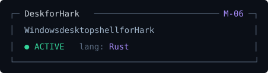
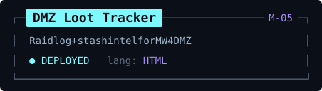
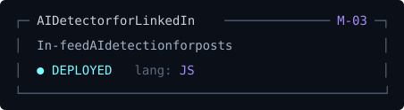
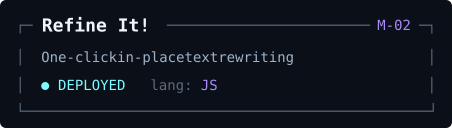
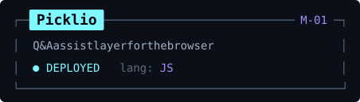

  

  <code>STATUS: ONLINE</code>&nbsp;&nbsp;<code>NODE: DUBAI</code>&nbsp;&nbsp;<code>MODE: NIGHT SHIFT</code>

I connect business and technology. When an idea won't leave me alone, I ship it. 
Operator: Mayas Ötegen

 

### ◢ Active modules

 

 

### ◢ Tech stack

  

### ◢ Telemetry

  

<code>&gt; END OF TRANSMISSION · midnightlab.dev</code>

